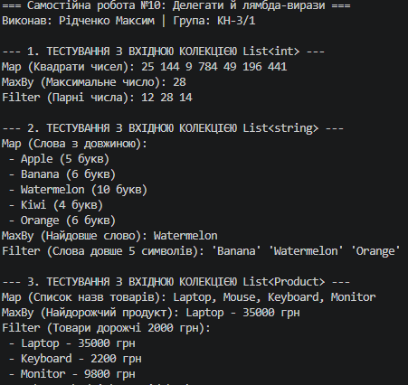

# ЗВІТ
### з самостійної роботи №10
**З дисципліни:** «Об’єктно-орієнтоване програмування»  
**Тема:** Делегати й лямбда-вирази: власні утиліти для колекцій  
**Студент:** Рідченко Максим  
**Група:** КН-3/1  

---

## 1. Мета роботи
Поглибити розуміння делегатів та лямбда-виразів через створення власних узагальнених методів-утиліт для роботи з колекціями та повторного використання логіки.

---

## 2. Відповіді на завдання та контрольні запитання

1. **Чому делегати корисні для створення таких утиліт?**  
   Делегати дозволяють передавати логіку/функціональність (поведінку) як параметр у метод. Це робить алгоритми обходу колекцій узагальненими: метод відповідає лише за ітерацію, а конкретна дія над елементом визначається ззовні.

2. **Як лямбда-вирази спрощують виклик цих методів?**  
   Лямбда-вирази забезпечують лаконічний анонімний синтаксис (наприклад, `x => x.Price > 1000`) без необхідності оголошувати окремі статичні чи іменовані методи під кожну дрібну операцію.

3. **У чому різниця між `Func<T, TResult>`, `Action<T>` та `Predicate<T>`?**  
   - `Func<T, TResult>` повертає значення типу `TResult` (використовується для селекторів та мапінгу).
   - `Action<T>` не повертає нічого (`void`), виконує дію (побочний ефект, наприклад вивід на екран).
   - `Predicate<T>` повертає значення `bool` (використовується для перевірки умови/фільтрації).

4. **Порівняння власних методів `CollectionUtils` із вбудованими LINQ-операторами:**  
   - `CollectionUtils.Map` є аналогом `Enumerable.Select()`.
   - `CollectionUtils.MaxBy` є аналогом `Enumerable.MaxBy()` (.NET 6+).
   - `CollectionUtils.Filter` є аналогом `Enumerable.Where()`.
   - `CollectionUtils.ForEach` є аналогом `List<T>.ForEach()`.

5. **Коли корисніше реалізувати власні утиліти замість LINQ?**  
   У високонавантажених ділянках коду (performance-critical) для уникнення надлишкових алокацій пам'яті через ітератори й замикання, а також на обмежених/Embedded платформах або за відсутності підтримки бібліотеки System.Linq.

---

## 3. Приклад виводу програми

```text
=== Самостійна робота №10: Делегати й лямбда-вирази ===
Виконав: Рідченко Максим | Група: КН-3/1

--- 1. ТЕСТУВАННЯ З ВХІДНОЮ КОЛЕКЦІЄЮ List<int> ---
Map (Квадрати чисел): 25 144 9 784 49 196 441 
MaxBy (Максимальне число): 28
Filter (Парні числа): 12 28 14 

--- 2. ТЕСТУВАННЯ З ВХІДНОЮ КОЛЕКЦІЄЮ List<string> ---
Map (Слова з довжиною):
 - Apple (5 букв)
 - Banana (6 букв)
 - Watermelon (10 букв)
 - Kiwi (4 букв)
 - Orange (6 букв)
MaxBy (Найдовше слово): Watermelon
Filter (Слова довше 5 символів): 'Banana' 'Watermelon' 'Orange' 

--- 3. ТЕСТУВАННЯ З ВХІДНОЮ КОЛЕКЦІЄЮ List<Product> ---
Map (Список назв товарів): Laptop, Mouse, Keyboard, Monitor
MaxBy (Найдорожчий продукт): Laptop - 35000 грн
Filter (Товари дорожчі 2000 грн):
 - Laptop - 35000 грн
 - Keyboard - 2200 грн
 - Monitor - 9800 грн

 