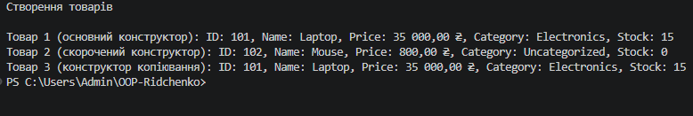

# ЗВІТ
### з самостійної роботи №2
**З дисципліни:** «Об’єктно-орієнтоване програмування»  
**Тема:** Перевантаження конструкторів: приклади та сценарії.  
**Студент:** Рідченко Максим  
**Група:** КН-3/1  

---

## 1. Мета роботи
Закріпити навички використання перевантажених конструкторів для створення гнучких та зручних у використанні класів на прикладі системи інтернет-магазину.

---

## 2. Теоретичні відомості
* **Перевантаження конструкторів:** створення кількох конструкторів у межах одного класу з різним набором параметрів.
* **Перенаправлення конструкторів (`: this(...)`):** механізм виклику одного конструктора з іншого для уникнення дублювання коду ініціалізації.
* **Властивості Read-Only:** властивості, що мають лише `get`-аксесор, забезпечують незмінність (immutability) об'єкта після його створення.

---

## 3. Хід виконання роботи

1. **Створення проєкту:** Створено консольний проєкт `IndependentWork2`.
2. **Реалізація класу `Product`:**
   * Оголошено приватні поля `_id`, `_name`, `_price`, `_category`, `_stockCount`.
   * Реалізовано публічні `read-only` властивості `Id`, `Name`, `Price`, `Category`, `StockCount`.
   * Створено 3 перевантажені конструктори:
     * **Основний:** ініціалізує всі 5 полів.
     * **Скорочений:** приймає `id`, `name`, `price`, а решту параметрів передає в основний через `: this(id, name, price, "Uncategorized", 0)`.
     * **Копіювання:** приймає інший об'єкт `Product` і викликає основний через `: this(other.Id, ...)`.
   * Перевизначено метод `ToString()` для зручного форматованого виводу інформації про товар.
3. **Тестування у `Main`:**
   * Створено товари за допомогою кожного з трьох конструкторів.
   * Виведено інформацію про товари у консоль з українською локалізацією валюти (`₴`).
4. **Git:** Створено коміт та завантажено проєкт на GitHub.

---

## 4. Відповіді на контрольні запитання

1. **Навіщо потрібне перевантаження конструкторів у класі `Product`:**  
   Воно забезпечує гнучкість при створенні об'єктів — дозволяє додавати товари з різним рівнем деталізації (як повні дані, так і мінімально необхідні).

2. **Чому конструктор копіювання зручно реалізовувати через `: this(...)`:**  
   Це усуває дублювання коду ініціалізації полів та гарантує, що вся логіка присвоєння знаходиться в одному центральному (основному) конструкторі.

3. **Які переваги дає read-only доступ до властивостей після створення об’єкта:**  
   Забезпечує цілісність та захист даних об'єкта від випадкових або несанкціонованих змін після його ініціалізації.

4. **У яких випадках перевизначення `ToString()` спрощує налагодження та демонстрацію:**  
   Визначення `ToString()` дозволяє виводити повну та зрозумілу інформацію про стан об'єкта однією командою (наприклад, `Console.WriteLine(product)`), не звертаючись до кожного поля окремо.

---

## 5. Висновок
Під час виконання самостійної роботи №2 було реалізовано клас `Product` із трьома перевантаженими конструкторами та викликом `: this(...)`, що дозволило засвоїти принципи створення гнучких класів і уникнення дублювання коду ініціалізації.

