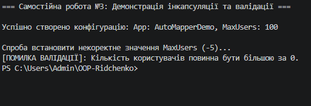

# ЗВІТ
### з самостійної роботи №3
**З дисципліни:** «Об’єктно-орієнтоване програмування»  
**Тема:** Аналіз інкапсуляції в open-source проєктах. Практики валідації полів.  
**Студент:** Рідченко Максим  
**Група:** КН-3/1  

---

## 1. Мета роботи
Дослідити реалізацію принципів інкапсуляції та валідації даних у реальному open-source проєкті на C# (AutoMapper), а також проаналізувати практичні підходи до захисту стану об'єктів і перевірки властивостей.

---

## 2. Теоретичні відомості
* **Інкапсуляція:** приховування внутрішньої реалізації класу та надання доступу до даних лише через контрольовані публічні інтерфейси (властивості, методи).
* **Read-Only властивості:** властивості з доступним аксесором `get` та відсутнім/закритим `set`, що забезпечують незмінність стану об'єкта після його ініціалізації.
* **Fail-Fast валідація:** підхід, за якого коректність вхідних даних перевіряється на самому початку (у конструкторах чи сеттерах), викидаючи винятки (`ArgumentNullException`, `ArgumentException`) у разі невідповідності.

---

## 3. Хід виконання роботи

1. **Вибір та аналіз Open-Source проєкту:**
   * Обрано репозиторій бібліотеки **[AutoMapper](https://github.com/AutoMapper/AutoMapper)**.
   * Досліджено класи [`MapperConfiguration.cs`](https://github.com/AutoMapper/AutoMapper/blob/main/src/AutoMapper/MapperConfiguration.cs) та [`ResolutionContext.cs`](https://github.com/AutoMapper/AutoMapper/blob/main/src/AutoMapper/ResolutionContext.cs).

2. **Аналіз інкапсуляції в обраних класах:**
   * **Клас `MapperConfiguration`:**
     * *Поля:* Закриті приватні поля з модифікатором `readonly` для захисту конфігурації.
       ```csharp
       private readonly IConfigurationProvider _configurationProvider;
       private readonly TypeMapRegistry _typeMapRegistry;
       ```
     * *Властивості:* Використання read-only властивостей та автовластивостей без публічного `set`.
       ```csharp
       public IConfigurationProvider ConfigurationProvider => _configurationProvider;
       public bool EnableNullPropagationOnQueryMembers { get; }
       ```
   * **Клас `ResolutionContext`:**
     * *Поля:* Приватні словники для зберігання контексту виконання.
       ```csharp
       private Dictionary<ContextCacheKey, object> _items;
       ```
     * *Індексатор:* Реалізовано спеціальний індексатор для зручного доступу до даних за ключем.
       ```csharp
       public object this[string key]
       {
           get => Items.TryGetValue(new ContextCacheKey(key), out var value) ? value : null;
           set => Items[new ContextCacheKey(key)] = value;
       }
       ```

3. **Дослідження практик валідації:**
   * Перевірка на `null` за допомогою сучасних методів .NET:
     ```csharp
     public MapperConfiguration(MapperConfigurationExpression configurationExpression)
     {
         ArgumentNullException.ThrowIfNull(configurationExpression);
     }
     ```
   * Перевірка стану об'єкта та викидання винятків:
     ```csharp
     public void AssertConfigurationIsValid()
     {
         if (_typeMaps.Length == 0)
         {
             throw new InvalidOperationException("No mapping configuration found.");
         }
     }
     ```

4. **Розробка та тестування власної демонстрації у `Program.cs`:**
   * Створено клас `UserConfiguration` із приватною валідацією полів та `set`-аксесором.
   * Перевірено перехоплення винятку при спробі встановити некоректні дані (`MaxUsers = -5`).

5. **Git:** Створено коміт та завантажено проєкт на GitHub.

---

## 4. Відповіді на контрольні запитання

1. **За якими ознаками можна зробити висновок, що в класі дотримано інкапсуляції:**  
   Усі поля класу є приватними (`private`) або `readonly`, доступ до них надається виключно через властивості, стан об'єкта захищений від неконтрольованої зміни ззовні, а перевірка коректності даних здійснюється всередині класу.

2. **Які підходи до валідації властивостей ви зустріли в реальному коді:**  
   Використання винятків (`ArgumentNullException.ThrowIfNull`, `InvalidOperationException`), перевірка умов `if` у сеттерах/конструкторах та виклики методів валідації стану (наприклад, `AssertConfigurationIsValid`).

3. **Чому для аналізу важливо наводити посилання на конкретні класи та фрагменти коду:**  
   Це підтверджує достовірність аналізу, дає змогу оцінити контекст використання архітектурних паттернів та демонструє практичне застосування принципів ООП у реальних продуктових бібліотеках.

4. **Які висновки щодо якості проєктування ви зробили після порівняння 2-3 класів:**  
   Якісний open-source код прагне мінімізувати мутабельність (віддає перевагу `read-only` властивостям) та суворо валідує вхідні дані при ініціалізації, що робить кодову базу надійною та передбачуваною.

---

## 5. Висновок
Під час виконання самостійної роботи №3 було досліджено реалізацію інкапсуляції та валідації в open-source проєкті AutoMapper. Це дозволило закріпити знання про захист внутрішнього стану класів за допомогою приватних полів, `read-only` властивостей, індексаторів та перевірки вхідних даних через винятки.

