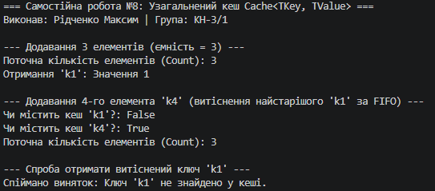
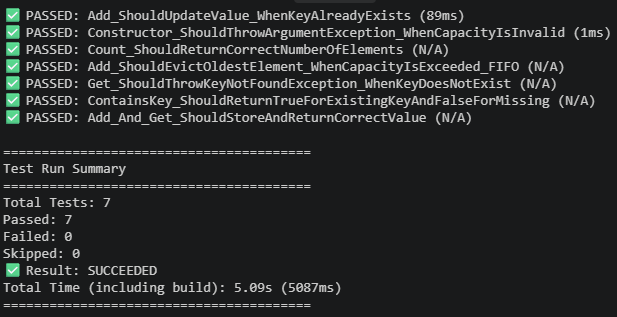

# ЗВІТ
### з самостійної роботи №8
**З дисципліни:** «Об’єктно-орієнтоване програмування»  
**Тема:** Узагальнений кеш Cache<TKey, TValue> із тестами  
**Студент:** Рідченко Максим  
**Група:** КН-3/1  

---

## 1. Мета роботи
Розробити узагальнений клас кешу `Cache<TKey, TValue>`, який зберігає дані за ключем та має політику видалення найстаріших елементів (FIFO - First In, First Out), а також написати юніт-тести для перевірки його функціональності.

---

## 2. Відповіді на контрольні запитання

1. **Які переваги надає `Cache<TKey, TValue>` порівняно з окремими неузагальненими реалізаціями кешу?**  
   Узагальнений клас забезпечує строгу типізацію, перевикористання коду для будь-яких типів ключів і значень (без упаковки/розпаковки boxing/unboxing для значущих типів) та виявлення помилок типів ще на етапі компіляції.

2. **Чому для реалізації політики FIFO зручно поєднувати `Dictionary<TKey, TValue>` з `Queue<TKey>` або `LinkedList<TKey>`?**  
   `Dictionary` гарантує швидкий доступ, додавання та перевірку наявності ключів за $O(1)$, а `Queue` відстежує точний порядок додавання елементів (FIFO), дозволяючи вилучати найстаріший ключ методом `Dequeue()` за $O(1)$.

3. **У яких випадках метод `Get` повинен викидати `KeyNotFoundException`, а коли доцільніше використовувати підхід на кшталт `TryGetValue`?**  
   `Get` викидає `KeyNotFoundException`, коли наявність ключа є обов'язковою за контрактним вимогами і його відсутність вважається помилкою. `TryGetValue` використовують для безпечного отримання значень без генерування винятків, коли відсутність ключа є очікуваним варіантом поведінки.

4. **Які тести є критично важливими для перевірки політики витіснення елементів з кешу?**  
   - Тест на переповнення ємності (додавання $N+1$ елемента в кеш ємністю $N$).
   - Тест перевірки вилучення саме найстарішого елемента (FIFO).
   - Тест спроби отримання витісненого елемента через `Get` (перевірка на `KeyNotFoundException`).
   - Тест збереження розміру кешу `Count == Capacity` після переповнення.

---

## 3. Висновок
У ході самостійної роботи №8 було реалізовано узагальнений клас кешу з обмеженою ємністю та політикою FIFO, а також створено комплект юніт-тестів xUnit у проєкті `IndependentWork8.Tests`, що повністю покривають усі можливі сценарії використання.

