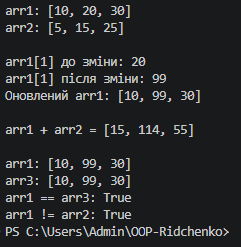

# ЗВІТ
### з лабораторної роботи №5
**З дисципліни:** «Об’єктно-орієнтоване програмування»  
**Тема:** Індексатори та перевантаження операторів.  
**Студент(ка):** Рідченко Максим 
**Група:** КН-3/1  
**Варіант:** №1 (Клас `IntArray`)  

---

1. **Що таке індексатор і для чого він використовується:**  
   Це інструмент, який дозволяє звертатися до об'єкта через квадратні дужки `obj[index]`, як до звичайного масиву.

2. **Різниця між індексатором та властивістю:**  
   Властивість викликається за іменем (`obj.Length`), а індексатор — за допомогою індексу в дужках (`obj[0]`).

3. **Які оператори можна перевантажувати:**  
   Арифметичні (`+`, `-`, `*`), порівняння (`==`, `!=`, `>`, `<`) та унарні (`++`, `--`). Не можна перевантажувати `=`, `&&`, `||`, `.`.

4. **Чому при `==` та `!=` перевизначають `Equals()` і `GetHashCode()`:**  
   Щоб порівняння через `==` та метод `.Equals()` працювали однаково і об'єкти коректно зберігалися у словниках чи хеш-сетях.

5. **Як індексатори підвищують читабельність коду:**  
   Вони спрощують синтаксис — замість довгих методів на кшталт `array.GetElement(0)` пишеться коротке `array[0]`.

---

## 6. Висновок
Під час лабораторної роботи №5 було створено клас `IntArray`, реалізовано індексатор для зручного доступу до елементов масиву та перевантажено оператори `+`, `==`, `!=`. На практиці засвоєно принципи створення виразних класів-колекцій у C#.

