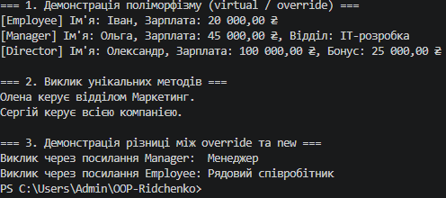

# ЗВІТ
### з лабораторної роботи №6
**З дисципліни:** «Об’єктно-орієнтоване програмування»  
**Тема:** Наслідування. Ключові слова base, override, virtual. Приховування членів (new).  
**Студент:** Рідченко Максим  
**Група:** КН-3/1    
**Варіант:** №1 (Ієрархія `Employee` → `Manager` → `Director`)  

---

## 1. Мета роботи
Навчитися створювати ієрархії класів, використовувати ключові слова `base`, `virtual`, `override` для реалізації поліморфізму, а також розуміти відмінності між `override` та приховуванням членів за допомогою `new`.

---

## 2. Теоретичні відомості
* **Наслідування:** механізм ООП, що дозволяє похідному класу успадковувати функціональність базового класу ("є-різновидом").
* **`base`:** використовується для доступу до членів базового класу, зокрема виклику його конструкторів або методів.
* **`virtual`:** модифікатор, що дозволяє похідним класам перевизначати метод базового класу.
* **`override`:** забезпечує поліморфізм, надаючи нову реалізацію віртуального методу у похідному класі.
* **`new`:** приховує успадкований член базового класу. Виклик методу залежить від типу посилання, а не від типу об'єкта.

---

## 3. Хід виконання роботи

1. **Створення проєкту:** У терміналі створено консольний проєкт за допомогою команди `dotnet new console -o OOP-Ridchenko/lab6v1`.
2. **Реалізація ієрархії:**
   * Створено базовий клас `Employee` із полями `Name`, `Salary`, віртуальним методом `DisplayInfo()` та невиртуальним `GetRole()`.
   * Створено похідний клас `Manager`, який викликає конструктор базового через `base(...)`, перевизначає `DisplayInfo()`, додає метод `ManageTeam()` та приховує `GetRole()` за допомогою `new`.
   * Створено похідний клас `Director`, який перевизначає `DisplayInfo()` та додає метод `LeadCompany()`.
3. **Тестування у `Main`:**
   * Продемонстровано поліморфізм через масив `Employee[]` та виклик `DisplayInfo()`.
   * Перевірено роботу унікальних методів похідних класів.
   * Показово порівняно виклик прихованого методу `GetRole()` через посилання `Manager` та `Employee`.
4. **Git:** Створено коміт та завантажено проєкт на GitHub.

---

## 4. Відповіді на контрольні запитання

1. **Принцип наслідування в ООП та приклад:**  
   Це створення нового класу на основі існуючого з успадкуванням його функціоналу. Приклад: базовий клас "Транспорт" і похідні "Автомобіль", "Велосипед".

2. **Для чого використовується `base`:**  
   Для виклику конструктора базового класу (`: base(...)`) або його методів (`base.DisplayInfo()`).

3. **Різниця між `virtual` та `override`:**  
   `virtual` у базовому класі **дозволяє** перевизначити метод, а `override` у похідному **заміщує** його новою реалізацією.

4. **Коли використовувати `new` та наслідки:**  
   Використовується для навмисного приховування невиртуального методу базового класу. Наслідок: метод обирається за типом посилання, а не за фактичним типом об'єкта (поліморфізм не працює).

---

## 5. Висновок
Під час лабораторної роботи №6 було реалізовано ієрархію класів `Employee` → `Manager` → `Director`, практично засвоєно роботу механізму наслідування, ключових слів `base`, `virtual`, `override` та показано різницю у поведінці `override` та `new`.

