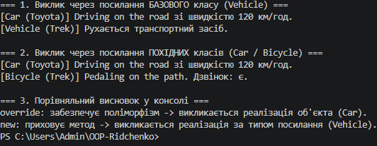

# ЗВІТ
### з лабораторної роботи №7
**З дисципліни:** «Об’єктно-орієнтоване програмування»  
**Тема:** Приховування методів (new) vs перевизначення (override).  
**Студент:** Рідченко Максим  
**Група:** КН-3/1    
**Варіант:** №1 (Ієрархія `Vehicle` → `Car` / `Bicycle`)  

---

## 1. Мета роботи
Зрозуміти різницю між приховуванням методів за допомогою ключового слова `new` та перевизначенням через `virtual`/`override`, а також навчитися правильно обирати між цими підходами.

---

## 2. Теоретичні відомості
* **`override` (Перевизначення):** змінює поведінку `virtual` методу базового класу. Забезпечує динамічне зв'язування (поліморфізм) — виклик залежить від реального типу об'єкта.
* **`new` (Приховування):** створює новий метод у похідному класі, що "ховає" метод базового класу. Забезпечує статичне зв'язування — виклик залежить від типу посилання.

---

## 3. Хід виконання роботи

1. **Створення проєкту:** У терміналі створено консольний проєкт за допомогою команди `dotnet new console -o OOP-Ridchenko/lab7v1`.
2. **Реалізація ієрархії:**
   * Базовий клас `Vehicle` із віртуальним методом `Move()`.
   * Похідний клас `Car` (клас A), який перевизначає метод `Move()` за допомогою `override`.
   * Похідний клас `Bicycle` (клас B), який приховує метод `Move()` за допомогою `new`.
3. **Тестування у `Main`:**
   * Створено об'єкти `Car` та `Bicycle` і збережено їх у змінних типу `Vehicle`.
   * Викликано `Move()` через посилання базового класу `Vehicle` та через явне приведення до похідних типів.
   * Наочно продемонстровано роботу поліморфізму для `override` та статичного вибору методу для `new`.
4. **Git:** Створено коміт та завантажено проєкт на GitHub.

---

## 4. Відповіді на контрольні запитання

1. **Різниця між `override` та `new`:**  
   `override` заміщує віртуальний метод і працює за типом об'єкта (поліморфізм), а `new` створює окремий метод і працює за типом посилання.

2. **Що таке поліморфізм і як `override` його забезпечує:**  
   Поліморфізм — це здатність об'єктів різних класів реагувати на один і той самий виклик по-різному. `override` забезпечує його через динамічне зв'язування під час виконання програми.

3. **Чому при `new` немає динамічного зв’язування:**  
   Тому що `new` не перевизначає метод у таблиці віртуальних методів, а створює абсолютно новий метод, який компілятор зв'язує ще на етапі компіляції (статично).

4. **Коли доцільно використовувати `new`:**  
   Коли потрібно додати метод у похідний клас з таким самим ім'ям, як у базовому, але без зміни поведінки базового класу або коли базовий метод не є `virtual`.

5. **Що станеться, якщо забути вказати `new`:**  
   Код скомпільовується, але компілятор видасть попередження (warning), підказка про те, що відбулося приховування за замовчуванням.

---

## 5. Висновок
Під час лабораторної роботи №7 було створено ієрархію `Vehicle` → `Car` / `Bicycle` та на практиці досліджено відмінність між `override` (динамічний поліморфізм) та `new` (статичне приховування методів).

