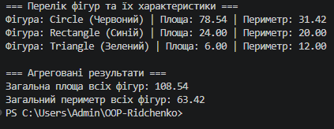

# ЗВІТ
### з лабораторної роботи №8
**З дисципліни:** «Об’єктно-орієнтоване програмування»  
**Тема:** Поліморфізм: динамічне зв’язування та перевизначення методів.  
**Студент:** Рідченко Максим  
**Група:** КН-3/1   
**Варіант:** №1 (Поліморфні фігури: `Shape` → `Circle`, `Rectangle`, `Triangle`)  

---

## 1. Мета роботи
Навчитися реалізовувати поліморфну поведінку за допомогою віртуальних методів та їх перевизначення, а також агрегувати результати поліморфних викликів.

---

## 2. Теоретичні відомості
* **Поліморфізм:** здатність об’єктів різних класів реагувати на однаковий виклик методу по-різному, залежно від їхнього фактичного типу.
* **Динамічне зв’язування (Late Binding):** визначення того, який саме метод буде викликано, відбувається під час виконання програми.
* **`virtual` та `override`:** модифікатор `virtual` у базовому класі дозволяє перевизначення, а `override` у похідному класі надає нову конкретну реалізацію.

---

## 3. Хід виконання роботи

1. **Створення проєкту:** У терміналі створено консольний проєкт за допомогою команди `dotnet new console -o OOP-Ridchenko/lab8v1`.
2. **Реалізація ієрархії:**
   * Базовий клас `Shape` з властивістю `Color` та віртуальними методами `GetArea()` і `GetPerimeter()`.
   * Похідний клас `Circle` з радіусом `Radius`.
   * Похідний клас `Rectangle` з шириною `Width` та висотою `Height`.
   * Похідний клас `Triangle` із трьома сторонами та обчисленням площі за формулою Герона.
3. **Тестування та агрегація у `Main`:**
   * Створено колекцію `List<Shape>`, що містить екземпляри `Circle`, `Rectangle` та `Triangle`.
   * Реалізовано цикл для поліморфного виклику методів `GetArea()` та `GetPerimeter()`.
   * Виконано агрегацію обчисленням сумарної площі та сумарного периметра всіх фігур.
4. **Git:** Створено коміт та завантажено проєкт на GitHub.

---

## 4. Відповіді на контрольні запитання

1. **Що таке поліморфізм і як він реалізується через `virtual` та `override`:**  
   Це здатність викликати один метод для різних об'єктів і отримувати різну поведінку. `virtual` позначає метод у базовому класі як доступний для зміни, а `override` у похідному класі надає його нову реалізацію.

2. **Що таке динамічне зв'язування та відмінність від статичного:**  
   При динамічному зв'язуванні конкретний метод обирається під час виконання програми (за типом об'єкта), а при статичному — під час компіляції (за типом посилання).

3. **Як поліморфізм робить код гнучким та розширюваним:**  
   Він дозволяє додавати нові похідні класи (наприклад, `Square` або `Pentagon`) без зміни існуючого коду, який працює з базовим типом `Shape`.

4. **Переваги колекцій базових типів:**  
   Дозволяють зберігати та обробляти об'єкти різних похідних типів в одному списку (наприклад, `List<Shape>`), обробляючи їх у єдиному циклі.

---

## 5. Висновок
Під час лабораторної роботи №8 було реалізовано ієрархію `Shape` → `Circle`, `Rectangle`, `Triangle`, практично досліджені механізми динамічного зв'язування та виконано агрегацію результатів поліморфних викликів.

