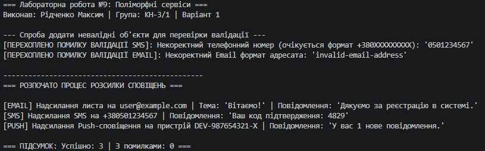

# ЗВІТ
### з лабораторної роботи №9
**З дисципліни:** «Об’єктно-орієнтоване програмування»  
**Тема:** Поліморфні сервіси: Notification (Email/SMS/Push)  
**Студент:** Рідченко Максим  
**Група:** КН-3/1  

---

## 1. Мета роботи
Застосувати поліморфізм для створення системи сповіщень з різними каналами доставки, навчитися обробляти помилки в поліморфних класах та використовувати списки базового типу для роботи з різними реалізаціями.

---

## 2. Теоретичні відомості
* **Поліморфізм через спадкування:** базовий клас або інтерфейс визначає контракт (набір методів), а похідні класи реалізують специфічну поведінку. Клієнтський код працює з базовим типом, не залежачи від конкретної реалізації.
* **Абстрактні класи:** класи, які містять сигнатури методів без реалізації (абстрактні методи), що зобов'язують похідні класи надати власну реалізацію за допомогою ключового слова `override`.
* **Обробка помилок у поліморфних системах:** використання блоків `try-catch` та винятків (`ArgumentException`) дозволяє ізолювати помилки окремих об'єктів без зупинки всієї системи розсилки.

---

## 3. Хід виконання роботи

1. **Створення проєкту:** Створено консольний проєкт `lab9v1` у директорії `OOP-Ridchenko`.
2. **Реалізація абстрактного базового класу `Notification`:**
   * Оголошено властивості `Recipient` та `Message` із валідацією.
   * Визначено абстрактний метод `Send()` та захищений абстрактний метод валідації `ValidateRecipient()`.
3. **Реалізація похідних класів (Варіант 1):**
   * **`EmailNotification`:** додано валідацію формату email через регулярні вирази (`Regex`) та властивість `Subject`.
   * **`SMSNotification`:** додано валідацію українського номера телефону у форматі `+380XXXXXXXXX`.
   * **`PushNotification`:** додано валідацію довжини `DeviceId` (не менше 8 символів).
4. **Реалізація сервісу `NotificationService`:**
   * Створено метод `SendAll(List<Notification> notifications)`, який обходить список базового типу, викликає поліморфний метод `Send()` та перехоплює винятки у разі збоїв.
5. **Тестування у `Main`:**
   * Створено список `List<Notification>` та додано об'єкти всіх трьох типів.
   * Демонстровано валідацію та обробку некоректних даних (перехоплення винятків).
   * Викликано `SendAll()` для демонстрації поліморфного виконання.
6. **Git:** Створено коміт та завантажено проєкт на GitHub.

---

## 4. Відповіді на контрольні запитання

1. **Що таке поліморфізм і як він реалізується через спадкування:**  
   Поліморфізм — це здатність об'єктів різних класів реагувати на один і той самий виклик методу по-різному. Через спадкування він реалізується шляхом перевизначення (`override`) віртуальних або абстрактних методів базового класу у похідних класах.

2. **Яка різниця між абстрактним класом та інтерфейсом:**  
   Абстрактний клас може містити реалізовані методи, поля та конструктори, а клас може успадковувати лише один базовий клас. Інтерфейс описує виключно контракт (без стану та полів, хоча C# підтримує дефолтні реалізації), а клас може імплементувати декілька інтерфейсів одночасно.

3. **Чому поліморфізм зручний для роботи зі списками різних типів:**  
   Він дозволяє зберігати об'єкти різних похідних класів у єдиній колекції базового типу (наприклад, `List<Notification>`) і обробляти їх у єдиному циклі без необхідності перевірки їхнього конкретного типу за допомогою `if` чи `switch`.

4. **Як обробляти специфічні помилки в поліморфних системах:**  
   Специфічні помилки обробляються через згенеровані винятки (`throw new ArgumentException(...)`) безпосередньо у відповідних похідних класах або через огортання поліморфного виклику в блок `try-catch` всередині сервісного методу обробки.

5. **Наведіть приклад з реального життя, де застосовується поліморфізм:**  
   Платіжні системи: є базовий клас `PaymentProcessor` з методом `Pay()`, а похідні класи `CreditCardPayment`, `PayPalPayment`, `CryptoPayment` реалізують власну логіку списання коштів. Інтернет-магазин просто викликає `Pay()` для будь-якого обраного клієнтом способу оплати.

---

## 5. Висновок
Під час виконання лабораторної роботи №9 було реалізовано поліморфну систему сповіщень `Notification` з трьома каналами доставки (`Email`, `SMS`, `Push`). Створений сервіс `NotificationService` продемонстрував зручність використання колекцій базового типу `List<Notification>` та стійкість поліморфної системи до помилок завдяки валідації вхідних даних та обробці винятків.

