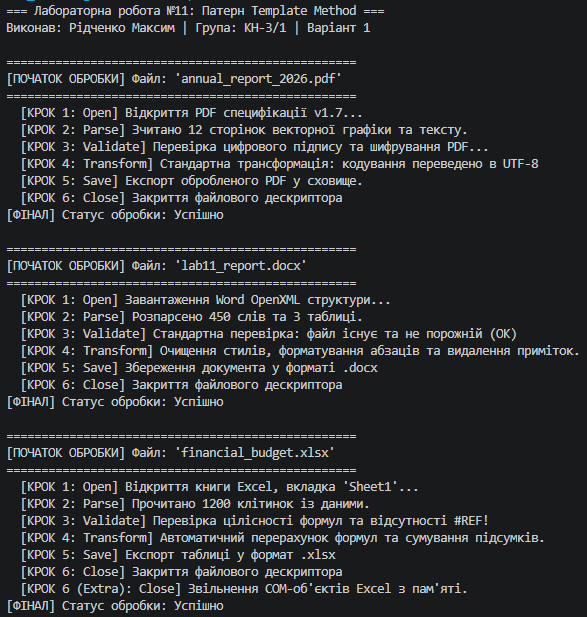

# ЗВІТ
### з лабораторної роботи №11
**З дисципліни:** «Об’єктно-орієнтоване програмування»  
**Тема:** DocumentProcessor: шаблонні кроки й реалізації (Template Method)  
**Студент:** Рідченко Максим  
**Група:** КН-3/1  

---

## 1. Мета роботи
Навчитися використовувати абстрактні класи для реалізації патерну Template Method (Шаблонний метод), створювати загальну логіку обробки в базовому класі та специфічну логіку в похідних класах.

---

## 2. Теоретичні відомості
* **Патерн Template Method:** поведінковий шаблон проектування, який визначає скелет алгоритму в базовому класі, дозволяючи похідним класам перевизначати окремі кроки алгоритму без зміни його загальної структури.
* **Абстрактні кроки (`abstract`):** обов'язкові кроки алгоритму, які не мають базової реалізації і повинні бути реалізовані у кожному похідному класі.
* **Віртуальні кроки (`virtual`):** опціональні кроки (так звані "хуки" або hooks), які надають дефолтну поведінку, але можуть бути перевизначені за потреби.

---

## 3. Хід виконання роботи

1. **Створення проєкту:** Створено консольний проєкт `lab11v1` у директорії `OOP-Ridchenko`.
2. **Реалізація абстрактного класу `DocumentProcessor`:**
   * Створено шаблонний метод `Process()`, який визначає фіксований алгоритм із 6 кроків: `Open` -> `Parse` -> `Validate` -> `Transform` -> `Save` -> `Close`.
   * Оголошено абстрактні методи: `Open()`, `Parse()`, `Save()`.
   * Оголошено віртуальні методи з базовою реалізацією: `Validate()`, `Transform()`, `Close()`.
3. **Реалізація похідних класів (Варіант 1):**
   * **`PDFProcessor`:** реалізовано обов'язкові методи та перевизначено `Validate()` для перевірки підпису.
   * **`WordProcessor`:** реалізовано обов'язкові методи та перевизначено `Transform()` для очищення стилів.
   * **`ExcelProcessor`:** реалізовано обов'язкові методи, перевизначено `Validate()`, `Transform()` та `Close()` для очищення COM-пам'яті.
4. **Тестування у `Main`:**
   * Створено колекцію `List<DocumentProcessor>` та викликано шаблонний метод `Process()` для кожного об'єкта.
5. **Git:** Створено коміт та завантажено проєкт на GitHub.

---

## 4. Відповіді на контрольні запитання

1. **Що таке патерн Template Method і для чого він використовується:**  
   Це поведінковий патерн, який фіксує послідовність виконання кроків алгоритму в базовому класі, дозволяючи похідним класам змінювати реалізацію конкретних кроків без порушення загального порядку виконання.

2. **Яка різниця між абстрактними та віртуальними методами в контексті цього патерну:**  
   Абстрактні методи зобов'язують похідні класи надати власну реалізацію (обов'язкові кроки), а віртуальні методи надають за замовчуванням базову реалізацію, яку похідні класи можуть перевизначити за потреби (опціональні кроки).

3. **Які переваги дає винесення спільної логіки в базовий клас:**  
   Усуває дублювання коду (принцип DRY), забезпечує єдиний порядок виконання алгоритму для всіх типів та спрощує підтримку коду (зміна загальної логіки робиться в одному місці).

4. **Коли доцільно використовувати Template Method замість інтерфейсів:**  
   Коли класи мають спільну послідовність кроків або готову базову логіку, яку недоцільно повторювати у кожному класі. Інтерфейси лише декларують контракти без реалізації та не фіксують порядок виконання алгоритму.

5. **Наведіть приклад з реального життя, де застосовується цей патерн:**  
   Приготування напоїв у кавовому автоматі: заварювання гарячою водою та наливання у склянку однакові для всіх, але кроки засипання (кава, чай, какао) та додавання топінгів (цукор, молоко) відрізняються залежно від вибраного напою.

---

## 5. Висновок
Під час виконання лабораторної роботи №11 було практично опановано патерн `Template Method`. На прикладі `DocumentProcessor` продемонстровано побудову гнучкого алгоритму обробки документів, де базовий клас керує послідовністю дій, а похідні класи реалізують специфічні деталі.

