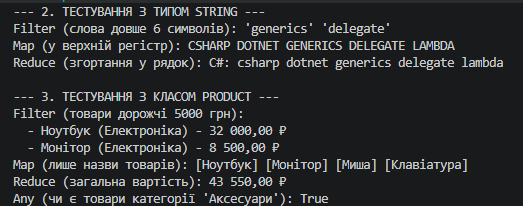

# ЗВІТ
### з лабораторної роботи №13
**З дисципліни:** «Об’єктно-орієнтоване програмування»  
**Тема:** Generic-методи для повторного використання компонентів: Mapper/MaxBy/Reduce з Func/Action  
**Студент:** Рідченко Максим  
**Група:** КН-3/1  

---

## 1. Мета роботи
Навчитися створювати узагальнені (generic) методи для повторного використання логіки, використовувати делегати `Func<T, TResult>` та `Action<T>` як параметри поведінки й реалізовувати типові операції над колекціями (`Map`, `Filter`, `Reduce`, `ForEach`, `Any`).

---

## 2. Теоретичні відомості
* **Generic-методи:** методи, що оперують параметрами типів, дозволяючи виконувати однакову логіку над різними типами даних із збереженням строгої типізації.
* **`Func<T, TResult>`:** узагальнений делегат для функцій, які приймають параметр типу `T` та повертають результат типу `TResult`.
* **`Action<T>`:** узагальнений делегат для процедур, які приймають параметр типу `T` і не повертають значення (`void`).
* **Функції вищого порядку:** функції, які приймають інші функції (делегати) як аргументи або повертають їх.

---

## 3. Перелік реалізованих методів (Варіант 1)

1. **`Map<T, TResult>`:** трансформує кожен елемент списку `List<T>` у тип `TResult` за допомогою предикату `Func<T, TResult>`.
2. **`Filter<T>`:** фільтрує список `List<T>`, залишаючи лише елементи, для яких `Func<T, bool>` повертає `true`.
3. **`Reduce<T, TAccumulate>`:** послідовно згортає список до єдиного значення акумулятора `TAccumulate`.
4. **`ForEach<T>`:** застосовує дію `Action<T>` до кожного елемента списку.
5. **`Any<T>`:** перевіряє за допомогою `Func<T, bool>`, чи відповідає хоча б один елемент списку заданій умові.

---

## 4. Відповіді на контрольні запитання

1. **Що таке generic методи і які переваги вони дають?**  
   Це методи, параметр типу яких визначається під час виклику. Вони дають повторне використання коду (DRY), високу продуктивність (без boxing/unboxing) та контроль помилок на етапі компіляції.

2. **Яка різниця між делегатами `Func<T>` та `Action<T>`?**  
   `Func<...>` завжди повертає значення вказаного типу (останній тип у списку generics є типом повернення), тоді як `Action<...>` повертає `void`.

3. **Що таке функції вищого порядку? Наведіть приклади.**  
   Це функції, що приймають інші функції як параметри або повертають їх. Приклади з C#: `List.FindAll()`, `LINQ Select()`, `Where()`, `Aggregate()`, а також наші методи `Map` і `Filter`.

4. **Навіщо потрібні обмеження (constraints) для generic типів?**  
   Обмеження (`where T : ...`) сповіщають компілятор про інтерфейси, базові класи або конструктори, які має тип `T`, що дозволяє викликати відповідні методи (наприклад, `CompareTo` при `where T : IComparable<T>`).

5. **Як лямбда-вирази спрощують роботу з делегатами?**  
   Вони дозволяють записувати анонімні функції лаконічно за допомогою оператора `=>` (наприклад, `x => x % 2 == 0`) без необхідності оголошувати окремі класи або класичні методи.

---

## 5. Висновок
У ході лабораторної роботи №13 було реалізовано узагальнені методи вищого порядку в класі `FunctionalUtils`. Продемонстровано їх універсальність під час роботи з типами `int`, `string` та кастомним класом `Product`.

