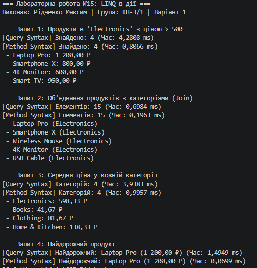

# ЗВІТ
### з лабораторної роботи №15
**З дисципліни:** «Об’єктно-орієнтоване програмування»  
**Тема:** LINQ в дії: фільтри, join, агрегації. Продуктивність  
**Студент:** Рідченко Максим  
**Група:** КН-3/1  

---

## 1. Мета роботи
Навчитися ефективно використовувати LINQ для фільтрації, об’єднання (join) та агрегації даних, а також аналізувати продуктивність LINQ-запитів за допомогою `Stopwatch`.

---

## 2. Перелік реалізованих запитів (Варіант 1)

1. **Фільтрація та Join:** Пошук усіх продуктів у категорії "Electronics" з ціною більше 500.
2. **Об’єднання (Join):** Комбінування списку продуктів із назвами їхніх категорій.
3. **Групування та Агрегація (GroupBy + Average):** Обчислення середньої ціни продуктів для кожної категорії.
4. **Пошук екстремуму (OrderByDescending + FirstOrDefault):** Знаходження найдорожчого продукту у списку.

Кожен запит реалізовано як у **Query Syntax** (синтаксис запитів), так і в **Method Syntax** (синтаксис методів розширення).

---

## 3. Відповіді на контрольні запитання

1. **Поясніть різницю між синтаксисом запитів та синтаксисом методів у LINQ. Коли який краще використовувати?**  
   *Query Syntax* має вигляд декларативних команд (`from ... in ... where ... select`), що схоже на SQL; він зручніший для складних запитів із багатьма `join` або `group`. *Method Syntax* використовує методи розширення та лямбда-вирази (`.Where().Select()`); він універсальніший і підтримує всі оператори LINQ (наприклад, `Take`, `Skip`, `FirstOrDefault`).

2. **Для чого використовуються операції Join та GroupJoin? У чому їхня відмінність?**  
   `Join` об'єднує дві колекції за збігом ключів і повертає плаский список відповідних пар (аналог `INNER JOIN` у SQL). `GroupJoin` об'єднує елементи лівої колекції з групою відповідних елементів правої колекції (аналог `LEFT OUTER JOIN` з групуванням).

3. **Наведіть приклади агрегуючих операцій LINQ та поясніть їхнє призначення.**  
   `Sum()` (обчислення суми), `Average()` (обчислення середнього арифметичного), `Count()` (підрахунок кількості), `Min()` / `Max()` (знаходження мінімального/максимального значення), `Aggregate()` (кастомна згортка колекції).

4. **Як можна виміряти продуктивність LINQ-запитів? Які фактори впливають на неї?**  
   Продуктивність вимірюється за допомогою класу `System.Diagnostics.Stopwatch`. На швидкість впливають: тип виконуваної операції (складність $O(N)$ чи $O(N \log N)$), обсяг даних, використання матеріалізації (`ToList()`, `ToArray()`), а також відкладене виконання (Deferred Execution).

---

## 4. Висновок
Під час виконання лабораторної роботи №15 було вивчено роботу LINQ-операторів. Найбільш часоємними виявилися операції групування та сортування великих масивів даних через складність впорядкування та індексування.

