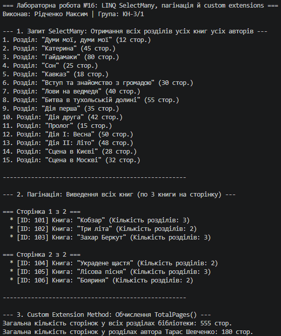

# ЗВІТ
### з лабораторної роботи №16
**З дисципліни:** «Об’єктно-орієнтоване програмування»  
**Тема:** LINQ: SelectMany, пагінація й custom extensions  
**Студент:** Рідченко Максим  
**Група:** КН-3/1  

---

## 1. Мета роботи
Навчитися використовувати оператор LINQ `SelectMany` для розгортання вкладених колекцій, реалізовувати посторінкову пагінацію даних за допомогою методів `Skip()` та `Take()`, а також створювати власні методи розширення (Custom Extension Methods) для доменних сутностей.

---

## 2. Перелік реалізованих завдань (Варіант 1)

1. **Створення сутностей предметної області:** Класи `Author`, `Book` та `Chapter` із вкладеними колекціями даних.
2. **Розгортання вкладених колекцій (SelectMany):** Запит для отримання плаского списку всіх розділів усіх книг усіх авторів.
3. **Реалізація пагінації:** Посторінковий вивід книг (по 3 книги на сторінку) з використанням операторів `Skip()` та `Take()`.
4. **Створення методу розширення:** Кастомний метод розширення `TotalPages()` для `IEnumerable<Chapter>`, який обчислює сумарну кількість сторінок.

---

## 3. Відповіді на контрольні запитання

1. **У чому полягає відмінність між операторами Select та SelectMany у LINQ?**  
   Оператор `Select` виконує проекцію один до одного (повертає колекцію результатів для кожного елемента, що в разі вкладених колекцій дає `IEnumerable<IEnumerable<T>>`). Оператор `SelectMany` виконує проекцію один до багатьох і розгортає (сплющує/flattening) вкладені колекції в одну пласку послідовність `IEnumerable<T>`.

2. **Як працює механізм пагінації за допомогою Skip() та Take()?**  
   `Skip(pageSize * (pageNumber - 1))` пропускає вказану кількість елементів від початку колекції (елементи попередніх сторінок), а `Take(pageSize)` вибирає наступну фіксовану кількість елементів для поточної сторінки.

3. **Які вимоги до синтаксису висуваються при створенні методів розширення (Extension Methods) в C#?**  
   Метод розширення повинен бути оголошений у `static` класі як `static` метод. Перший параметр має містити модифікатор `this` перед типом, який розширюється (наприклад, `public static int TotalPages(this IEnumerable<Chapter> chapters)`).

4. **У яких випадках доцільно створювати власні методи розширення для IEnumerable<T>?**  
   Кастомні методи розширення доцільні для винесення повторюваної бізнес-логіки агрегації або фільтрації, покращення читабельності коду (стиль Fluent API) та додавання функціональності до типів, до вихідного коду яких немає прямого доступу.

---

## 4. Висновок
Під час виконання лабораторної роботи №16 було практично опановано роботу з вкладеними структурами даних у LINQ. Застосування `SelectMany` дозволило швидко розгорнути двопапочну структуру авторів та їхніх книг у єдиний список розділів, оператори `Skip` і `Take` забезпечили гнучку пагінацію, а створення розширення `TotalPages()` спростило обчислення обсягу сторінок.

