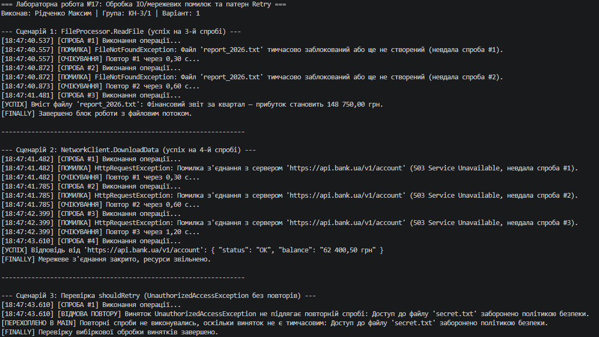

# ЗВІТ
### з лабораторної роботи №17
**З дисципліни:** «Об’єктно-орієнтоване програмування»  
**Тема:** Обробка IO/мережевих помилок та патерн Retry  
**Студент:** Рідченко Максим  
**Група:** КН-3/1  

---

## 1. Мета роботи
Навчитися обробляти типові помилки вводу/виводу та мережеві помилки за допомогою конструкції `try-catch-finally`, а також реалізувати узагальнений патерн Retry з експоненційною затримкою для підвищення відмовостійкості застосунків.

---

## 2. Перелік реалізованих завдань (Варіант 1)

1. **Реалізація класу `FileProcessor`:** Створено метод `ReadFile(string path)`, який імітує тимчасову недоступність файлу (`FileNotFoundException` під час перших 2 спроб та успішне повернення даних на 3-й спробі), а також виняток доступу `UnauthorizedAccessException` для перевірки фільтрації помилок.
2. **Реалізація класу `NetworkClient`:** Створено метод `DownloadData(string url)`, який імітує мережевий збій (`HttpRequestException` під час перших 3 спроб та успішне завантаження даних на 4-й спробі).
3. **Реалізація узагальненого класу `RetryHelper`:** Розроблено статичний узагальнений метод `ExecuteWithRetry<T>`, що підтримує налаштування максимальної кількості повторів (`retryCount`), експоненційну затримку (`initialDelay * 2^retryAttempt`), вибіркову перевірку винятків через делегат `shouldRetry` та логування кожної спроби.
4. **Демонстрація в `Main`:** Перевірено сценарії відновлення після тимчасових збоїв для `FileProcessor` та `NetworkClient`, роботу блоків `try-catch-finally`, а також негайне переривання операції при виникненні нетимчасового винятку (`UnauthorizedAccessException`).

---

## 3. Відповіді на контрольні запитання

1. **Які типи винятків найчастіше виникають при роботі з файлами та мережею?**  
   Під час роботи з файловою системою найчастіше виникають `FileNotFoundException` (файл не знайдено), `DirectoryNotFoundException` (шлях не існує), `UnauthorizedAccessException` (немає прав доступу) та базовий `IOException` (файл зайнятий іншим процесом або помилка читання/запису). Під час мережевої взаємодії виникають `HttpRequestException` (помилки HTTP-запитів, недоступність вузла), `SocketException` (розрив з'єднання на рівні сокетів) та `TaskCanceledException` / `TimeoutException` (перевищення часу очікування відповіді).

2. **Поясніть принцип роботи патерну Retry. Коли його доцільно використовувати?**  
   Патерн Retry полягає в автоматичному повторному виконанні операції, яка завершилася збоєм, із певним інтервалом очікування. Його доцільно використовувати виключно для тимчасових (transient) помилок — короткочасних втрат мережевого зв'язку, перевантаження сервера (HTTP 503/429) або тимчасового блокування файлу, які з високою ймовірністю зникнуть через кілька секунд.

3. **Як реалізувати експоненційну затримку між повторними спробами?**  
   Експоненційна затримка реалізується шляхом множення початкового інтервалу очікування на двійку в степені номера поточної повторної спроби: $\text{delay} = \text{initialDelay} \times 2^{\text{retryAttempt}}$. Наприклад, при початковій затримці 300 мс наступні паузи становитимуть 300 мс, 600 мс, 1200 мс, що дає зовнішньому ресурсу більше часу на відновлення.

4. **Для чого потрібен делегат `shouldRetry` у допоміжному класі `RetryHelper`?**  
   Делегат `Func<Exception, bool>` дозволяє відокремити тимчасові помилки від критичних (фатальних). Якщо виникає виняток, який неможливо виправити повторними спробами (наприклад, `UnauthorizedAccessException` або `ArgumentNullException`), `shouldRetry` повертає `false`, і цикл повторів одразу зупиняється без марної витрати часу та ресурсів.

---

## 4. Висновок
Під час виконання лабораторної роботи №17 було реалізовано патерн Retry з експоненційною затримкою. Використання формули `initialDelay * 2^retryAttempt` забезпечує поступове збільшення інтервалу між спробами, що знижує навантаження на нестабільний ресурс і дає йому час відновити працездатність. Застосування делегата `shouldRetry` разом із блоками `try-catch-finally` дозволяє безпечно обробляти тимчасові збої та коректно звільняти ресурси.

