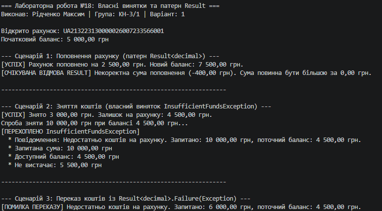

# ЗВІТ
### з лабораторної роботи №18
**З дисципліни:** «Об’єктно-орієнтоване програмування»  
**Тема:** Власні винятки та патерн Result  
**Студент:** Рідченко Максим  
**Група:** КН-3/1  

---

## 1. Мета роботи
Навчитися створювати власні класи винятків для специфічних помилок предметної області, а також реалізовувати узагальнений патерн `Result<T>` для контрольованої обробки очікуваних сценаріїв невдачі без генерації винятків.

---

## 2. Перелік реалізованих завдань (Варіант 1)

1. **Створення власного винятку `InsufficientFundsException`:** Реалізовано клас винятку, успадкований від `System.Exception`, зі стандартними конструкторами (включно з конструктором серіалізації) та додатковими властивостями `RequestedAmount` і `CurrentBalance`.
2. **Реалізація узагальненого класу `Result<T>`:** Створено клас із властивостями `IsSuccess`, `Value`, `Error`, приватним конструктором та статичними фабричними методами `Success(T value)`, `Failure(string error)` і `Failure(Exception ex)`.
3. **Розробка сервісу `AccountService`:** Реалізовано методи керування банківським рахунком:
   - `Withdraw(decimal amount)` — викидає `InsufficientFundsException`, якщо сума зняття перевищує поточний баланс.
   - `Deposit(decimal amount)` — повертає `Result<decimal>.Success` при коректному поповненні або `Result<decimal>.Failure` при некоректній сумі (`amount <= 0`).
   - `TransferTo(string recipientAccount, decimal amount)` — демонструє обгортання винятку в `Result<decimal>.Failure(Exception)`.
4. **Демонстрація в `Main`:** Перевірено обидва підходи обробки помилок із виведенням грошових сум у гривнях (`грн`).

---

## 3. Відповіді на контрольні запитання

1. **Навіщо створювати власні типи винятків? Які переваги це дає?**  
   Власні типи винятків дозволяють чітко розрізняти помилки бізнес-логіки від системних помилок .NET, перехоплювати конкретні винятки у блоках `catch (InsufficientFundsException)` та передавати разом із помилкою структуровані контекстні дані (наприклад, запитану суму та залишок на рахунку).

2. **Які стандартні конструктори рекомендується реалізовувати для власних винятків?**  
   Рекомендується реалізовувати три базові публічні конструктори: без параметрів `()`, із текстовим повідомленням `(string message)`, із повідомленням та внутрішнім винятком `(string message, Exception innerException)`, а також захищений конструктор для серіалізації `(SerializationInfo info, StreamingContext context)` і спеціалізовані конструктори для заповнення власних властивостей.

3. **Поясніть патерн Result. У яких випадках його використання є більш доцільним, ніж викидання винятків?**  
   Патерн `Result<T>` інкапсулює результат виконання операції в один об'єкт, який містить прапорець успіху (`IsSuccess`), корисне значення (`Value`) або опис помилки (`Error`). Його використання є більш доцільним для очікуваних і частих сценаріїв невдачі (помилки валідації вводу користувача, невірний формат даних, відсутність запису під час пошуку), оскільки створення винятків та розкручування стеку викликів (stack unwinding) створюють значні накладні витрати на продуктивність.

4. **Які сценарії краще обробляти через винятки, а які через патерн Result?**  
   - **Через винятки:** непередбачувані технічні збої або порушення критичних інваріантів, коли метод не може виконати свій контракт (відсутність підключення до БД, пошкодження файлу, нестача коштів при транзакції списання, `NullReferenceException`).
   - **Через патерн Result:** очікувані бізнес-перевірки та валідація вхідних параметрів (введення від'ємної суми поповнення, некоректний email, перевищення денного ліміту), які є штатною частиною потоку виконання програми.

---

## 4. Висновок
Під час виконання лабораторної роботи №18 було реалізовано два підходи до обробки помилок у банківському сервісі `AccountService`. Для методу `Deposit` доцільно застосовувати `Result<decimal>`, оскільки введення користувачем некоректної суми (`<= 0`) є очікуваною помилкою валідації, яку зручно обробити без витрат ресурсів на винятки. Для методу `Withdraw` доцільно використовувати власний виняток `InsufficientFundsException`, оскільки спроба списати більше коштів, ніж є на рахунку, порушує фінансовий інваріант операції та вимагає переривання транзакції з передачею деталей про дефіцит коштів.

